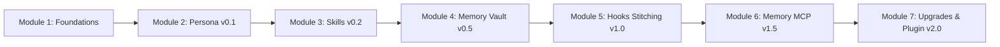

# Personal AI Harness in Antigravity — Curriculum & Course Plan

This course takes you from foundational concepts to a working, inspectable **Personal AI Harness** running natively inside Google Antigravity. You will have a usable conversational system early (Module 2) and upgrade it incrementally—learning *why* each layer exists before writing a single line of code.

---

## Teaching Philosophy & Lesson Rhythm

Every module follows the same four-step loop so you never feel lost or overwhelmed:

1. **Concept First:** Plain-English mental models and diagrams before touching any config or code.
2. **Design Preview:** We agree on the exact files and architecture before creating them.
3. **Small, Clean Builds:** Short, readable files with clear comments—no black-box magic.
4. **Code Review & Live Test:** We walk through what we built line-by-line, test it across real conversations, and verify it works before advancing.

---

## Learning & Upgrade Roadmap

---

## Course Modules

### Module 1: Foundations — How Agents, Context Windows & Antigravity Work
**Goal:** Build the mental models you need to make architectural decisions confidently.

* **What You Will Learn:**
  * **Tokens & the Context Window:** Why context is "working RAM" (fast, finite, resets on a new thread) and what causes *context rot* in long chats.
  * **Compaction vs. External Memory:** What `/compact` solves—and why long-term continuity still requires storage outside the prompt.
  * **Antigravity's 5 Building Blocks:** When to use **Rules** (`GEMINI.md` / `AGENTS.md`), **Skills** (`SKILL.md`), **Hooks** (`hooks.json`), **MCP Servers** (`mcp_config.json`), and **Plugins** (`plugin.json`).
  * **Scope & Precedence:** Workspace `.agents/` vs. global `~/.gemini/config/`.
* **Hands-On Exercise:** Map out the full lifecycle of one prompt inside Antigravity.
* **Exit Criteria:** You can look at a feature idea ("remember my goals" vs. "run a morning review") and know which Antigravity primitive belongs to it.

---

### Module 2: Build v0.1 — Identity, Voice & Ground Rules (`GEMINI.md`)
**Goal:** Create a talkable persona with a consistent voice and clear behavior—zero code required.

* **What You Will Learn:**
  * How directory-scoped `GEMINI.md` / `AGENTS.md` files load automatically.
  * Context budgets (`24,000` bytes per rule file; `20,000`-token aggregate rules budget) and why concise rules outperform giant walls of text.
  * Prompt engineering for natural, human-feeling conversation without sycophancy or drift.
* **What We Build:**
  * Your harness workspace folder layout (`d:/repos/PersonaHarness`).
  * `GEMINI.md` defining persona identity, communication style, boundaries, and memory habits.
* **Review Checkpoint:** Test the persona across 2–3 prompts, review every section of `GEMINI.md`, and tune tone/directness.

---

### Module 3: Build v0.2 — On-Demand Habits Without Context Bloat (`SKILL.md`)
**Goal:** Give your persona specialized capabilities without stuffing them into every prompt.

* **What You Will Learn:**
  * **Progressive Disclosure:** Antigravity only loads skill *names* and *descriptions* upfront; full instructions load only when triggered.
  * Writing crisp `SKILL.md` frontmatter so the persona knows *when* to activate a workflow.
* **What We Build:**
  * **Skill 1 (`session-wrapup`):** A repeatable procedure for distilling a conversation into key decisions, facts, and open threads.
  * **Skill 2 (`socratic-deep-dive`):** A structured thinking-partner workflow for untangling fuzzy ideas and checking mental models.
* **Review Checkpoint:** Inspect the `SKILL.md` files and verify the persona triggers them accurately without manual micromanagement.

---

### Module 4: Build v0.5 — Human-Readable Long-Term Memory (The Memory Vault)
**Goal:** Solve the new-conversation amnesia problem using transparent, editable files.

* **What You Will Learn:**
  * The **Three Types of Agent Memory:**
    1. *Semantic Memory* — stable facts, preferences, and background (`profile.md`).
    2. *Working State* — active projects, open loops, current focus (`active_context.md`).
    3. *Episodic Memory* — dated summaries of past conversations (`episodes/YYYY-MM-DD.md`).
  * How to prevent memory clutter, contradictions, and stale facts.
* **What We Build:**
  * A structured local `memory/` vault with clear templates.
  * Updated persona instructions so the harness reads key memory on startup and updates it cleanly.
* **Review Checkpoint:** Have a real conversation, wrap it up, open a **brand-new chat window**, and verify the persona picks up seamlessly.

---

### Module 5: Build v1.0 — Automated Context Stitching (`hooks.json` & Transcripts)
**Goal:** Move from "remember to update memory" to automatic, deterministic stitching across context windows.

* **What You Will Learn:**
  * How Antigravity's lifecycle hooks (`SessionStart`, `PreInvocation`, `Stop`) work via JSON over `stdin` / `stdout`.
  * Reading `transcriptPath` (`transcript.jsonl`) and injecting startup context via `injectSteps` (`systemMessage`).
  * Why hooks run **synchronously** (blocking the loop) and how to keep them fast and safe.
* **What We Build:**
  * `.agents/hooks.json` wiring two small, heavily commented Python scripts:
    1. **`session_start.py`:** Automatically builds and injects a compact memory briefing whenever a new conversation opens.
    2. **`session_stop.py`:** Safely logs session metadata from `transcript.jsonl` after a turn finishes.
* **Code Review Checkpoint:** Full line-by-line walkthrough of JSON I/O, path handling, error safety, and latency testing.

---

### Module 6: Build v1.5 — Building Your Own Memory MCP Server
**Goal:** Replace brittle flat-file reading with a real queryable Memory MCP Server.

* **What You Will Learn:**
  * **MCP Architecture:** How Antigravity launches a local **Stdio** MCP server from `mcp_config.json`, discovers tools, and routes tool calls.
  * Designing clean tool contracts (`remember`, `recall`, `list_recent`, `update_memory`, `forget`) with clear schemas.
  * Keyword / full-text search (SQLite FTS5) vs. semantic/vector search tradeoffs.
* **What We Build:**
  * A clean, inspectable local Memory MCP server backed by SQLite FTS5.
  * Workspace plugin `mcp_config.json` integration and standalone unit tests so you can verify tool calls independently.
* **Code Review Checkpoint:** Walk through the server entrypoint, tool definitions, database queries, and test cross-conversation recall in Antigravity.

---

### Module 7: Build v2.0 — Packaging, Subagent Isolation & Future Upgrades
**Goal:** Harden your harness into a portable Antigravity Plugin and map out next-level enhancements.

* **What You Will Learn:**
  * **Subagent Context Isolation:** Delegating heavy research/browsing so noisy tool output never pollutes your persona's conversation window.
  * **Plugin Packaging (`plugin.json`):** Bundling rules, skills, hooks, and MCP config into one toggleable unit usable across all workspaces.
  * **Optional Next Upgrades:**
    * Semantic/embedding search in your Memory MCP server.
    * Proactive check-ins via `/schedule`.
    * Moving beyond Antigravity's UI using the **Antigravity Python SDK** (`google-antigravity`).
* **What We Build:**
  * A self-contained plugin directory structure (`plugin.json`, `rules/AGENTS.md`, `skills/`, `hooks.json`, `mcp_config.json`) + end-to-end verification checklist.

---

## Course Milestones Summary

| Version | After Module | What Your Personal Harness Can Do | Code Complexity |
| :--- | :--- | :--- | :--- |
| **v0.1** | Module 2 | Consistent persona, voice, and boundaries inside Antigravity | None (Markdown) |
| **v0.2** | Module 3 | On-demand personal workflows without bloating context | None (Markdown + YAML) |
| **v0.5** | Module 4 | Cross-conversation memory via human-readable Markdown vault | None (Structured Files) |
| **v1.0** | Module 5 | Automatic context stitching on new chats via lifecycle hooks | Light (2 small scripts) |
| **v1.5** | Module 6 | Searchable long-term memory via your own Memory MCP server | Moderate (~100–200 lines) |
| **v2.0** | Module 7 | Portable Antigravity Plugin + isolated subagents + optional upgrades | Modular & Production-ready |
