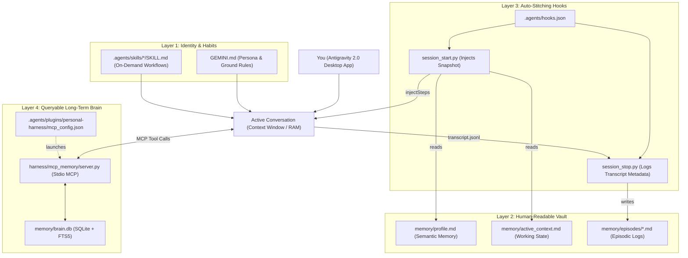
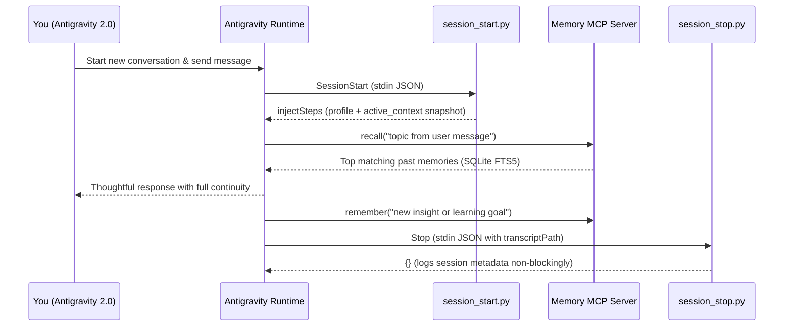

# Personal AI Harness — System Design Document

## 1. Overview & Design Goals

We are designing a local-first **Personal AI Harness** tailored to act as a **thinking partner, sounding board, and learning mentor** inside the **Antigravity 2.0 Desktop App**, housed in its own dedicated Git repository at `d:/repos/PersonaHarness` (ready for private GitHub backup).

### Core Design Principles
1. **Working RAM vs. Long-Term Disk:** Keep each conversation's context window clean and focused while storing durable knowledge outside the prompt.
2. **Human-Inspectable First:** Every memory starts as plain Markdown you can read and edit yourself; when we add SQLite search in `v1.5`, data remains local, transparent, and exportable.
3. **Beginner-Readable Python:** All scripts use clean, heavily commented Python. Phase 4 (`v1.0` hooks) uses **only Python's standard library** (zero third-party installs); Phase 5 (`v1.5` MCP server) uses Python's built-in `sqlite3` (with FTS5 full-text search) plus the official `mcp` package.
4. **Fail-Open Safety:** If a hook script ever errors, it logs the error quietly and returns valid empty JSON so your chat is never blocked.
5. **Clean Git Repo & Workspace Isolation:** Everything lives inside `d:/repos/PersonaHarness`—keeping code, docs, and customizations separate from other folders in `d:/Conversations`—with `.gitignore` guardrails before pushing to GitHub, and a clean path to package as a global Antigravity plugin in `v2.0`.

### Explicit Non-Goals (For v0.1 – v1.5)
* No cloud databases, external SaaS memory platforms, or paid vector hosting.
* No local GPU/embedding pipelines initially (SQLite FTS5 gives fast, deterministic search first; semantic embeddings are an optional `v2.0+` upgrade).

---

## 2. System Architecture

The harness grows in **four clean layers**, each mapped to a native Antigravity customization primitive:



### Runtime Flow: Opening a Brand-New Chat Window (`v1.5`)



---

## 3. Target Directory Layout (`d:/repos/PersonaHarness`)

Files are introduced gradually—nothing is created ahead of the module that teaches it.

```text
d:/repos/PersonaHarness/
├── .gitignore                             # [v0.1] Excludes .venv/, logs, brain.db, and OS clutter
├── GEMINI.md                              # [v0.1] Persona voice, mentoring style & memory rules
├── documents/                             # [v0.1] All course, design & session documentation
│   ├── curriculum_and_course_plan.md      #   7-module curriculum and learning roadmap
│   ├── design_document.md                 #   System architecture & contracts (this doc)
│   ├── implementation_plan.md             #   Phased build & verification checklist
│   └── conversations/                     #   Saved session notes & conversation exports
│       └── 2026-11-24_foundations.md      #     Founding planning & Module 1 session log
├── memory/                                # [v0.5] Human-readable memory vault
│   ├── profile.md                         #   Stable facts, learning style, preferences
│   ├── active_context.md                  #   Current questions, focus areas, open threads
│   ├── episodes/                          #   Dated conversation summaries (YYYY-MM-DD_slug.md)
│   └── brain.db                           # [v1.5] SQLite FTS5 searchable memory database (.gitignored)
├── .agents/
│   ├── skills/                            # [v0.2] On-demand workflows (progressive disclosure)
│   │   ├── session-wrapup/
│   │   │   └── SKILL.md
│   │   └── socratic-deep-dive/
│   │       └── SKILL.md
│   ├── hooks.json                         # [v1.0] Wires SessionStart and Stop hooks
│   └── plugins/                           # [v1.5] Workspace-scoped plugin hosting MCP config
│       └── personal-harness/
│           ├── plugin.json
│           └── mcp_config.json
├── harness/                               # [v1.0+] Inspectable Python source code & tests
│   ├── hooks/
│   │   ├── session_start.py               # [v1.0] Builds & injects startup briefing
│   │   ├── session_stop.py                # [v1.0] Parses transcriptPath & logs session info
│   │   └── test_hooks.py                  # [v1.0] Local test harness for hooks
│   ├── mcp_memory/
│   │   ├── db.py                          # [v1.5] SQLite + FTS5 storage layer
│   │   ├── server.py                      # [v1.5] Stdio MCP server exposing memory tools
│   │   └── test_memory.py                 # [v1.5] Standalone unit tests for memory DB
│   └── logs/
│       └── hooks.log                      # [v1.0] Local debug log (.gitignored, never breaks chat)
└── .venv/                                 # [v1.5] Local Python virtual environment (.gitignored)
```

> [!NOTE]
> **Why `.agents/plugins/personal-harness/mcp_config.json`?**
> In Antigravity, MCP servers are loaded either from global `~/.gemini/config/mcp_config.json` or from inside a plugin (`plugins/<name>/mcp_config.json`). Placing a minimal workspace plugin under `.agents/plugins/` keeps your entire harness self-contained inside `d:/repos/PersonaHarness` during development, and sets you up seamlessly for Module 7's full plugin packaging.

---

## 4. Three-Tier Memory Data Model

Designed specifically for a **thinking partner and learning mentor**:

| Tier | Storage | Purpose | Update Cadence | Size Target |
| :--- | :--- | :--- | :--- | :--- |
| **1. Semantic Memory** | `memory/profile.md` | Who you are, how you learn best, communication preferences (e.g., directness, analogies vs. rigor), enduring interests. | Rare (only when preferences or background meaningfully evolve). | Under 800 words |
| **2. Working Context** | `memory/active_context.md` | Active learning topics, current mental models you are refining, open questions, ongoing projects. | Every few sessions (stale items pruned or archived). | Under 800 words |
| **3. Episodic & Atomic Memory** | `memory/episodes/*.md` + `memory/brain.db` | Dated conversation summaries plus searchable atomic takeaways (decisions, insights, concepts learned, open questions). | Append-only after meaningful conversations. | Unbounded (retrieved selectively) |

### SQLite Schema (`memory/brain.db` — Introduced in `v1.5`)

```sql
CREATE TABLE IF NOT EXISTS memories (
    id INTEGER PRIMARY KEY AUTOINCREMENT,
    category TEXT NOT NULL,          -- 'preference' | 'concept' | 'question' | 'insight' | 'project' | 'episode'
    content TEXT NOT NULL,           -- Plain-English atomic memory
    tags TEXT DEFAULT '',            -- Comma-separated keywords, e.g. 'antigravity,hooks,python'
    source_conversation_id TEXT,     -- Optional Antigravity conversationId
    created_at TEXT NOT NULL,        -- ISO-8601 UTC timestamp
    updated_at TEXT NOT NULL,        -- ISO-8601 UTC timestamp
    archived INTEGER DEFAULT 0       -- Soft delete (0 = active, 1 = archived)
);

-- Full-Text Search virtual table kept in sync with memories
CREATE VIRTUAL TABLE IF NOT EXISTS memories_fts USING fts5(
    content,
    tags,
    category,
    content='memories',
    content_rowid='id'
);
```

---

## 5. Component Specifications & Contracts

### 5.1 Persona Rules (`GEMINI.md` — `v0.1`)
* **Tone & Demeanor:** Warm, intellectually honest, curious, concise. Avoids empty praise; challenges assumptions constructively when helpful; explains trade-offs plainly.
* **Teaching Behavior:** Checks understanding before jumping ahead; prefers mental models and concrete examples before jargon.
* **Memory Discipline (`v0.5+`):** Never silently assumes old facts are still true if contradicted; confirms before making major changes to `profile.md`; keeps summaries crisp.
* **Budget Guardrail:** Kept under `4,000` bytes (well below Antigravity's `24,000`-byte per-file cap and `20,000`-token aggregate rules budget).

### 5.2 On-Demand Skills (`.agents/skills/` — `v0.2`)
1. **`session-wrapup`:** Activated when you say "wrap up", "save what we learned", or finish a conversation. Distills the thread into: (a) key insights, (b) updates for `active_context.md`, and (c) an episodic summary file under `memory/episodes/`.
2. **`socratic-deep-dive`:** Activated when you want to think through an ambiguous idea or learn a tricky topic. Guides the discussion through structured questions, steelmanning alternatives, and checking mental models before proposing solutions.

### 5.3 Lifecycle Hooks (`.agents/hooks.json` — `v1.0`)
Hooks run synchronously via `cmd /c` on Windows with the working directory set to `.agents/` (where `hooks.json` lives).

* **`SessionStart` (`harness/hooks/session_start.py`):**
  * **Input (`stdin`):** Antigravity common payload (`conversationId`, `workspacePaths`, `transcriptPath`, `modelName`, `cwd`).
  * **Logic:** Reads `memory/profile.md`, `memory/active_context.md`, and the filenames/titles of the 3 most recent files in `memory/episodes/`. Enforces a strict character cap (e.g., `6,000` chars) so startup injection never bloats the context window.
  * **Output (`stdout`):**
    ```json
    {
      "injectSteps": [
        {
          "systemMessage": {
            "systemMessage": "## Startup Memory Snapshot\n..."
          }
        }
      ]
    }
    ```
  * **Timeout:** `5` seconds (target runtime: `< 100 ms`).

* **`Stop` (`harness/hooks/session_stop.py`):**
  * **Input (`stdin`):** Common payload plus `terminationReason`, `fullyIdle`, `continuationActive`.
  * **Logic:** Only acts when `terminationReason == "NO_TOOL_CALL"` and `continuationActive == false`. Reads lightweight metadata from `transcriptPath` (timestamp, conversation ID, turn count, last user prompt preview) and updates a local index file `memory/episodes/_session_index.jsonl` so you and the persona always know what past transcripts exist without blocking the UI.
  * **Output (`stdout`):** `{}` (allows turn to end cleanly).
  * **Timeout:** `5` seconds (target runtime: `< 100 ms`).

### 5.4 Memory MCP Server (`harness/mcp_memory/server.py` — `v1.5`)
Runs locally via **Stdio transport** and exposes five small, clear tools:

| Tool | Parameters | Behavior |
| :--- | :--- | :--- |
| `remember` | `content: str`, `category: str`, `tags: str = ""` | Inserts an atomic memory into SQLite + FTS5 and returns its new `id`. |
| `recall` | `query: str`, `category: str = ""`, `limit: int = 5` | Searches active (`archived = 0`) memories via FTS5 `BM25` ranking and returns matches with IDs, dates, and tags. |
| `list_recent` | `limit: int = 10`, `category: str = ""` | Lists the most recently created/updated active memories. |
| `update_memory` | `memory_id: int`, `content: str = ""`, `tags: str = ""` | Updates an existing memory's text or tags and refreshes `updated_at`. |
| `forget` | `memory_id: int` | Marks `archived = 1` (soft delete so mistakes are always recoverable). |

---

## 6. Safety, Privacy & Error-Handling Guardrails

* **Local-Only Storage:** All memories, logs, and SQLite databases live strictly inside `d:/repos/PersonaHarness/memory/` and `d:/repos/PersonaHarness/harness/logs/`.
* **Git / GitHub Backup Hygiene:** Use a **private** GitHub repository for `PersonaHarness`. `.gitignore` excludes `.venv/`, `harness/logs/`, and `memory/brain.db` (binary SQLite database), while personal Markdown files (`memory/*.md`, `documents/conversations/`) are backed up to the private repo.
* **Fail-Open Hook Wrapper:** Both Python hooks wrap `main()` in a `try/except` block that appends tracebacks to `harness/logs/hooks.log` and prints `{}` to `stdout` with exit code `0`.
* **Context Size Caps:** `session_start.py` truncates cleanly with a marker if `profile.md` or `active_context.md` grows past its budget, preventing runaway token growth.
* **No Silent Destructive Deletes:** `forget` uses soft archiving (`archived = 1`) rather than `DELETE FROM`.
* **Safe Path Handling:** All file paths are resolved relative to the workspace root using Python's `pathlib.Path` to avoid Windows backslash escaping bugs.
